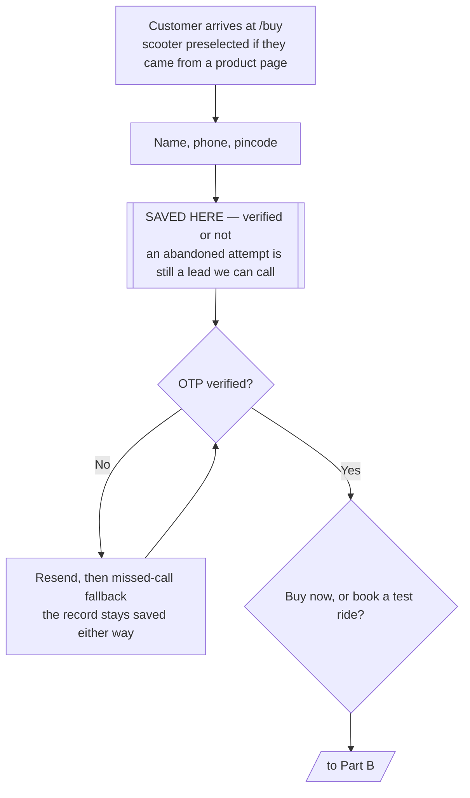
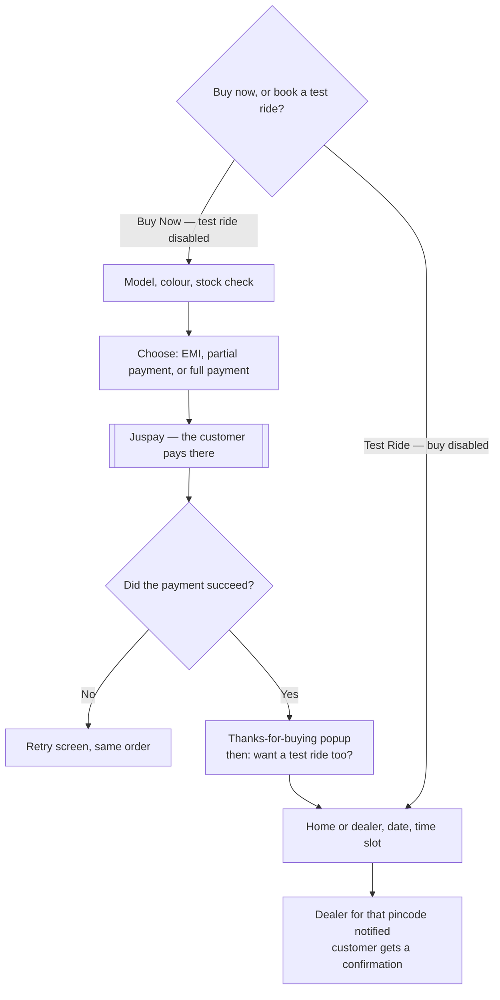

# Ampere `/buy` — Build Specification

**Project:** a new Ampere-owned booking page replacing `enquiry.ampere-electric.com`
**Version:** 2.0 — supersedes all earlier documents
**Status:** for build

---

## 1. What we are building

One page, at **`ampere-electric.com/buy`**, that every call-to-action on the main website points to. It replaces the third-party form at `enquiry.ampere-electric.com`, which Ampere does not own or control.

The page adapts to where the customer came from. Arriving from the homepage navbar, it opens in its default state. Arriving from a product page such as `/nexus-ex-plus`, it opens with that scooter already selected.

Every customer gives the same three details first — name, phone with OTP, pincode. Then the journey forks. They either **buy the scooter**, choosing between EMI, a partial payment, or paying in full, and are handed to Juspay to pay. Or they **book a test ride**, and the dealer covering their pincode is notified.

Two things shape the whole build:

**Details are saved before OTP is verified.** The moment a name, phone number and pincode are entered, that record exists in our database — verified or not. An abandoned attempt is still a lead somebody can call. This is the single most valuable decision in the specification and it dictates the data model.

**Inventory gates the purchase.** We hold a manual stock count per model per region. If a model is out of stock in the customer's region, they cannot pay for it.

---

## 2. Scope

### In scope

| Area | Included |
|---|---|
| Entry | Dynamic prefill from every CTA on the main site |
| Identity | Name, phone, OTP verification, pincode |
| Lead capture | Saved on entry, before verification |
| Buy journey | Model, colour, three payment options, Juspay handoff, return confirmation |
| Payment options | EMI, partial payment, full payment |
| EMI display | Widget built now, live plans wired in when Juspay access arrives |
| Test ride journey | Mode, date, slot, dealer notification |
| Inventory | Manual count per model per region, admin-managed, reserved during payment |
| Cross-sell | Test ride prompt after a completed purchase |
| Admin | Inventory management, lead and order views |

### Not in scope

Order tracking pages, self-serve cancellation, customer accounts or login, exchange and buyback, live stock feeds from dealer systems, delivery-date commitments.

### Deliberately open

**The partial payment amount is not yet decided.** It is built as configuration — a mode (fixed or percentage) and a value, held per model in the price book and editable from the admin page. Until a value is set, the option does not appear. No code changes when the decision arrives.

---

## 3. Entry points and prefill

### URL contract

```
/buy?model=nexus-ex-plus
    &colour=ocean-blue
    &intent=buy|testride
    &src=navbar|product_hero|product_sticky|homepage|dealer_locator|offers
    &utm_source=...&utm_medium=...&utm_campaign=...&gclid=...&fbclid=...
```

Rules:

- **Every parameter is optional.** `/buy` with no parameters renders a complete, working page.
- `model` preselects the scooter. `intent` preselects which journey is highlighted, but never removes the other.
- Invalid values are dropped silently and logged. `model=foo` falls back to no preselection rather than an error.
- The full original query string is saved on the lead regardless of what we parse, so attribution questions can be answered later without a code change.
- Parsing happens in the **server component**. No client-side redirect, no flash of an empty form.

### Current state to fix

On product pages today, the "Book a Test Ride" buttons link to the bare enquiry domain rather than a deep link. A customer who has read the Nexus EX+ page and chosen a colour arrives at a form that knows neither. Every CTA needs updating to the format above — that change alone recovers context that is currently thrown away on every click.

---

## 4. The customer journey

**Part A — everyone goes through this**



**Part B — the two branches**




### Journey rules

**Mutual exclusivity is a UI state, not a lock.** When the customer chooses Buy Now, the test ride option is disabled and visibly greyed. When they choose test ride, the buy option is disabled. After a successful purchase, the test ride option re-opens via the cross-sell prompt. A customer is never trapped in a branch.

**OTP gates progress, not capture.** The record is written when the three fields are filled. Verification is required to move past the identity step, but failing or abandoning it does not delete anything.

---

## 5. Lead capture and the micro-conversion

This is the part that most affects the numbers you will report, so it is specified precisely.

### When the record is written

As soon as name, phone and pincode are all present and syntactically valid — **before the OTP is sent**, not after it is verified. The record carries `phone_verified = false`.

On successful verification, the same record is updated to `phone_verified = true`. Every subsequent step patches the same record. There is never a second record for the same attempt.

### What this gives you

- A customer who abandons at the colour picker is still a lead with a verified phone and a known dealer
- A customer who never receives the OTP is still a lead, flagged as unverified, which is a different and lower-quality list but a real one
- Returning from the same device resumes where they left off rather than restarting
- The success metric becomes **total leads captured**, not just completed purchases — which matters, because completed online purchases will be a small number in month one and total leads will not

### Consent — read this before building

Storing the number is one thing; calling that person later is another. Under the DPDP Act it is the contacting that requires consent, and a customer who abandoned before OTP never reached a consent checkbox at the end of a form.

**Fix: put the consent line directly under the phone field, at step one.** Two separate checkboxes, recorded independently:

- *Transactional* — we may contact you about this enquiry. Required to proceed.
- *Marketing* — we may contact you about offers. Optional.

Record purpose, notice version, timestamp and IP for each. This is one line of copy and it makes the entire dead-lead strategy defensible instead of a liability.

### Unverified lead handling

Unverified leads are stored separately in reporting — same table, filtered by `phone_verified`. They are a lower-quality list because the number may be mistyped or false. Give them to the call centre as a distinct segment, not mixed in with verified leads, or the team will lose faith in the whole list after a run of dead numbers.

---

## 6. The buy journey

### Steps

1. **Model and colour** — preselected if the customer arrived from a product page, changeable at any point
2. **Stock check** — see Section 8. If the model is unavailable in the customer's region, the payment options do not appear; they see the position honestly and are offered a test ride instead
3. **Price** — the amount, itemised
4. **Payment option** — three choices, see below
5. **Terms and consent** — cancellation policy shown *before* payment
6. **Juspay** — the customer leaves to pay
7. **Return** — confirmation popup, then the test ride cross-sell

### The three payment options

| Option | What the customer pays | Status |
|---|---|---|
| **Pay in full** | The full amount | Ready to build |
| **Partial payment** | A deposit; balance at the dealer | **Amount not yet decided** — built as configuration |
| **EMI** | Monthly instalments | Widget built now, live plans when Juspay access arrives |

All three hand off to Juspay. Juspay runs the payment; we do not handle card details, and no payment credentials touch our infrastructure.

**What we pass to Juspay** is the order and the amount. The customer's choice sets which payment methods Juspay surfaces — Juspay supports filtering the methods shown, so choosing EMI opens a checkout with EMI plans in front, and choosing pay-in-full suppresses them. The customer can still change their mind on Juspay's page; the filter sets a default, it does not trap them.

**The partial payment option is hidden until configured.** The price book carries `partial_mode` (`fixed` or `percent`) and `partial_value` per model. Both null means the option does not render. When the decision is made it is a number typed into the admin page.

### Returning from Juspay

The customer comes back, and we show a confirmation popup — thanks for your purchase, order number, dealer name and phone — followed by the test ride prompt.

**One problem to be aware of.** Juspay's return to our page carries `order_id`, `dealer` and `amount`, and it carries the same three fields whether the payment succeeded or failed. Nothing in the return says which. Showing "thanks for buying" based on the return alone would be a guess, and guessing wrong on a payment screen is the worst error available to us.

So we do not trust the browser. The return tells us *which order to look up*; we then ask Juspay's servers directly. Section 9 covers this.

---

## 7. The test ride journey

Same page, same saved record, the buy option disabled while it runs.

1. **Mode** — at home, or at the dealership. Home requires a serviceable pincode; if not serviceable, fall back to dealership with an explanation rather than a dead end
2. **Date** — rolling seven-day window from today, matching the current form
3. **Time slot** — the four existing windows: 10:00–12:00, 13:00–15:00, 15:00–17:00, 17:00–20:00
4. **Confirm** — the dealer covering that pincode is notified, and the customer gets a confirmation

Inventory is **not** decremented by a test ride booking. Test rides use demo stock, which is a different thing from sale stock.

If a pincode maps to no active dealer, fall back to the nearest serviceable dealer rather than dead-ending the customer.

---

## 8. Inventory

Manual, updated roughly every fifteen days, counted **per model per region**.

### Model

```
inventory
  model_code    text
  region_code   text          -- derived from pincode
  units_total   int           -- what you type in (default 15)
  units_reserved int          -- held by in-flight payments
  updated_at    timestamptz
  updated_by    text
  PRIMARY KEY (model_code, region_code)
```

Available units = `units_total - units_reserved`.

A **region** is a group of states or a sales zone. We need the region list and its state mapping before build — pincode gives us the state, and the state maps to a region.

### Reservation

When a customer enters payment, one unit is reserved for **fifteen minutes**. If the payment succeeds, the reservation converts into a sale and `units_total` decrements. If it fails, is abandoned, or the window expires, the reservation is released and the unit returns to the pool.

Without this, two customers can pay for the last unit within the same minute and both succeed. Reservation and decrement run inside a database transaction with row-level locking, which is the main reason this project uses Postgres rather than a document store.

### Updating it

A small password-protected admin page. Five models across the region list is a grid on one screen — model down the side, region across the top, a number in each cell, one save button.

Three things it does that a spreadsheet cannot:

- **Validates** — no negatives, no typos, no text where a number belongs
- **Audits** — who changed what, when, and from what to what. You will want this the first time a number looks wrong
- **Applies instantly** — no sync lag between editing and the site reflecting it

Each row shows its last-updated date, and anything older than fifteen days is flagged with a warning banner. Stale inventory should announce itself rather than quietly overselling.

**Not recommended:** a Google Sheet as the source of truth. No validation, no audit trail, and anyone with the link can break it — a trailing space or a deleted row silently stops a model selling. For a number that controls whether you can accept payment, that is too fragile.

### When stock hits zero

The payment options do not render. The customer sees the model is currently unavailable in their area, with the lead time if known, and is offered a test ride or an alternative colour. They are never allowed to pay for something we cannot deliver.

---

## 9. Payments and Juspay

### What Juspay owns

Payment method selection, card and UPI handling, EMI plan eligibility, authentication, and the money. We never touch card details, which keeps our compliance scope minimal.

### What we own

Knowing, reliably, whether the payment happened.

### The problem

Juspay's return to our page carries `order_id`, `dealer` and `amount` — identical on success and on failure. There is no status field.

### The solution

Three mechanisms in a defined order of authority:

1. **Server-to-server webhook — the source of truth.** Juspay's servers tell our servers. This survives the customer closing the browser, which matters because UPI switches them into another app and back, and EMI authentication routes through their bank. Both drop browser sessions routinely.
2. **Status API — the reconciler.** When the customer returns before the webhook has landed, we ask Juspay directly.
3. **Return URL — navigation only.** It tells us which order to look up. Nothing more.

### Rules

- Webhook signatures are verified. Unsigned payloads are logged and dropped.
- Webhooks may arrive twice or out of order. `paid` is terminal; a paid order is never downgraded.
- The confirmation popup never reads the amount from the query string. Query parameters are attacker-controlled. It reads from our own record after resolution.
- If status cannot be resolved within about five seconds, show a **"confirming your payment"** state that polls, and send the confirmation by message when it resolves. Never guess, and never show a bare error to someone whose money may have left their account.
- A reconciliation job runs every five minutes over orders stuck in `initiated` for more than thirty minutes. This is what catches the customer whose webhook never arrived.

### Until Juspay access arrives

Every part of this is built against a **fake Juspay client** that returns scripted success, failure and timeout. The entire payment flow, including reconciliation, can be built and tested before real credentials exist. Swapping in the real client afterwards is a small change.

**Still needed from Juspay:** confirmation that the webhook exists and its signature scheme, the status API endpoint, and how to pass the payment method filter.

---

## 10. EMI

Build the widget now; wire the real plans in later.

### Now

A calculator taking amount, down payment and tenure, showing the monthly instalment, the interest, and the **total amount payable**. That last figure is the one most sites hide and it is what makes an EMI decision honest. Rates come from a configurable table until Juspay's plans are available.

Every display carries *indicative, subject to approval*. The widget never approves credit.

### Later

When Juspay access arrives, the plan list comes from their EMI Plans API, called server-side for the order amount and cached. The widget's interface does not change — only where its numbers come from.

### One thing to keep in mind

The financing advertised on the product pages — rates in the region of 6.99% — is a **vehicle loan** from a finance partner, arranged at the dealership. What Juspay provides is **checkout EMI** on a card or a buy-now-pay-later provider, at materially higher rates.

They are different products and they must be labelled differently wherever both appear, or a customer who sees 6.99% on the product page and a much higher rate at checkout will feel misled. Keep the distinction in the interface from the start; retrofitting it after complaints is worse.

---

## 11. Technology

| Layer | Choice |
|---|---|
| Framework | **Next.js 15**, App Router |
| UI | **React 19 + TypeScript**, `strict: true` |
| Styling | **Tailwind CSS** |
| Forms | React Hook Form + Zod, one schema shared client and server |
| Backend | **Next.js route handlers** — no separate service |
| Database | **PostgreSQL** |
| ORM | Prisma |
| Background jobs | One worker process, for dealer notification, reconciliation and reservation expiry |
| Messaging | WhatsApp via BSP, SMS with DLT-registered templates |
| Bot defence | Cloudflare Turnstile on the OTP endpoint |
| Errors | Sentry |
| Hosting | Vercel for the app, managed Postgres |

### Why no separate backend service

At the volumes involved, a separate API service is machinery without a purpose. Next.js route handlers with Prisma handle this comfortably, and it is one application to deploy, monitor and reason about instead of two. If this grows into something much larger, extracting a service later is straightforward. Building it now is cost without benefit.

### Why Postgres, not Mongo

Three reasons, in order of weight:

**Inventory correctness.** Two customers buying the last unit at the same moment must not both succeed. Postgres gives you row-level locking inside a transaction, in one line. In a document store you would be hand-rolling that, and getting it subtly wrong is the likely outcome.

**Money must reconcile.** A payment belongs to exactly one order, an order to one lead, a lead to one dealer. That is relational data with integrity constraints, and constraints the database enforces are worth more than constraints your code promises to remember.

**Reporting.** "Leads by dealer by week, split by verified and unverified, with conversion to purchase" is one SQL query. In Mongo it is an aggregation pipeline you will maintain by hand.

Mongo is the better tool when documents are genuinely schemaless and you are doing high-volume writes with no cross-entity integrity. That is not this.

### On scale

A thousand customers is not a scaling problem. Even at a thousand form submissions a *day*, that is roughly one write every ninety seconds — a small Postgres instance will not notice, and it would handle a hundred times that.

So the architecture is deliberately small. The engineering risk here is not throughput; it is **correctness around money and stock**. A payment recorded wrong, or a unit sold twice, costs more than any amount of latency. Build for that.

---

## 12. Data model

```sql
CREATE TYPE lead_intent  AS ENUM ('undecided','testride','buy');
CREATE TYPE order_status AS ENUM ('initiated','pending','paid','failed','expired','refunded');
CREATE TYPE payment_type AS ENUM ('full','partial','emi');

CREATE TABLE leads (
  id             uuid PRIMARY KEY DEFAULT gen_random_uuid(),
  name           text NOT NULL,
  phone          text NOT NULL,              -- encrypted at rest
  phone_hash     char(64) NOT NULL,          -- HMAC, for lookup
  phone_verified boolean NOT NULL DEFAULT false,
  pincode        char(6) NOT NULL,
  state_code     text,
  region_code    text,
  dealer_code    text REFERENCES dealers(dealer_code),
  model_code     text,
  colour_code    text,
  intent         lead_intent NOT NULL DEFAULT 'undecided',
  status         text NOT NULL DEFAULT 'new',
  src            text,
  utm            jsonb,
  gclid          text,
  fbclid         text,
  source_raw     jsonb,
  created_at     timestamptz NOT NULL DEFAULT now(),
  updated_at     timestamptz NOT NULL DEFAULT now()
);
CREATE INDEX ON leads (phone_hash);
CREATE INDEX ON leads (phone_verified, created_at DESC);
CREATE INDEX ON leads (dealer_code, status);

CREATE TABLE consents (
  id uuid PRIMARY KEY DEFAULT gen_random_uuid(),
  lead_id uuid NOT NULL REFERENCES leads(id),
  purpose text NOT NULL,                     -- 'transactional' | 'marketing'
  granted boolean NOT NULL,
  notice_version text NOT NULL,
  ip inet, user_agent text,
  granted_at timestamptz NOT NULL DEFAULT now()
);

CREATE TABLE inventory (
  model_code text NOT NULL,
  region_code text NOT NULL,
  units_total int NOT NULL DEFAULT 15 CHECK (units_total >= 0),
  units_reserved int NOT NULL DEFAULT 0 CHECK (units_reserved >= 0),
  updated_at timestamptz NOT NULL DEFAULT now(),
  updated_by text,
  PRIMARY KEY (model_code, region_code)
);

CREATE TABLE inventory_audit (
  id bigserial PRIMARY KEY,
  model_code text NOT NULL, region_code text NOT NULL,
  units_before int, units_after int,
  changed_by text NOT NULL,
  changed_at timestamptz NOT NULL DEFAULT now()
);

CREATE TABLE inventory_reservations (
  id uuid PRIMARY KEY DEFAULT gen_random_uuid(),
  order_id text NOT NULL,
  model_code text NOT NULL, region_code text NOT NULL,
  status text NOT NULL DEFAULT 'held',       -- held | converted | released
  expires_at timestamptz NOT NULL,
  created_at timestamptz NOT NULL DEFAULT now()
);
CREATE INDEX ON inventory_reservations (status, expires_at);

CREATE TABLE orders (
  order_id      text PRIMARY KEY,            -- Juspay-issued
  lead_id       uuid NOT NULL REFERENCES leads(id),
  dealer_code   text REFERENCES dealers(dealer_code),
  model_code    text NOT NULL,
  colour_code   text,
  region_code   text NOT NULL,
  payment_type  payment_type NOT NULL,
  amount_total  numeric(12,2) NOT NULL,      -- vehicle price
  amount_charged numeric(12,2) NOT NULL,     -- what Juspay collects now
  amount_paid   numeric(12,2),
  status        order_status NOT NULL DEFAULT 'initiated',
  status_source text,                        -- webhook | status_api
  juspay_status_raw text,
  emi_context   jsonb,                       -- what the widget displayed
  retry_count   int NOT NULL DEFAULT 0,
  created_at    timestamptz NOT NULL DEFAULT now(),
  paid_at       timestamptz
);
CREATE INDEX ON orders (status, created_at);
CREATE INDEX ON orders (lead_id);

CREATE TABLE payment_events (                -- append-only
  id bigserial PRIMARY KEY,
  order_id text NOT NULL,
  event_type text,
  signature_valid boolean NOT NULL,
  raw_payload jsonb NOT NULL,
  received_at timestamptz NOT NULL DEFAULT now()
);

CREATE TABLE test_ride_bookings (
  id uuid PRIMARY KEY DEFAULT gen_random_uuid(),
  lead_id uuid NOT NULL REFERENCES leads(id),
  dealer_code text NOT NULL REFERENCES dealers(dealer_code),
  model_code text NOT NULL, colour_code text,
  mode text NOT NULL,                        -- home | dealer
  slot_date date NOT NULL,
  slot_window text NOT NULL,                 -- w1..w4
  status text NOT NULL DEFAULT 'booked',
  created_at timestamptz NOT NULL DEFAULT now()
);

CREATE TABLE dealers (
  dealer_code text PRIMARY KEY,
  name text NOT NULL, phone text, address text,
  lat double precision, lng double precision,
  home_serviceable boolean NOT NULL DEFAULT false,
  active boolean NOT NULL DEFAULT true
);

CREATE TABLE pincode_map (
  pincode char(6) PRIMARY KEY,
  state_code text NOT NULL,
  region_code text NOT NULL,
  dealer_code text REFERENCES dealers(dealer_code)
);

CREATE TABLE price_book (
  model_code text NOT NULL,
  region_code text NOT NULL,
  amount_total numeric(12,2) NOT NULL,
  partial_mode text,                         -- 'fixed' | 'percent' | NULL
  partial_value numeric(12,2),               -- NULL = option hidden
  effective_from timestamptz NOT NULL DEFAULT now(),
  PRIMARY KEY (model_code, region_code, effective_from)
);
```

### Three rules

1. **Amounts are computed server-side** from `price_book`. The client sends selections, never money. A client-supplied amount is a trivially exploitable vulnerability.
2. **`order_id` is the join key** across lead, payment, inventory reservation and dealer record. Reused on retry, so one intent never becomes two orders.
3. **Phone is encrypted with a searchable HMAC index.** A plaintext indexed phone column is the first thing a DPDP audit finds.

---

## 13. API routes

```
POST   /api/leads                     save name, phone, pincode — before OTP
POST   /api/otp/request               send code (Turnstile-protected, rate-limited)
POST   /api/otp/verify                verify, set phone_verified, issue session
PATCH  /api/leads/me                  model, colour, intent — progressive update

GET    /api/catalog                   models, colours, prices
GET    /api/dealers/resolve?pincode=  dealer + region for a pincode
GET    /api/inventory?model=&pincode= availability in that region
GET    /api/emi/plans?model=&amount=  stubbed now, Juspay-backed later

POST   /api/orders                    reserve stock, create order, get Juspay session
GET    /api/orders/[id]/status        resolved status — never trust the browser
POST   /api/orders/[id]/retry         reuse the same order_id
POST   /api/webhooks/juspay           signature-verified, always returns 200

POST   /api/test-rides                book a slot, notify the dealer

GET    /api/admin/inventory           admin only
PUT    /api/admin/inventory           admin only, writes audit row
GET    /api/admin/leads               admin only, filterable by verified
```

Every mutating route accepts an `Idempotency-Key`. Build that interceptor before the order routes, not after.

---

## 14. Admin

A small internal area behind a password, later behind SSO.

| Screen | Purpose |
|---|---|
| **Inventory** | The grid. Models down, regions across, a number in each cell. Last-updated per row, stale rows flagged after fifteen days |
| **Leads** | Searchable, filterable by verified or unverified, exportable for the call centre |
| **Orders** | Status, payment type, amount, dealer. Reconciliation view for orders stuck in `initiated` |
| **Test rides** | Upcoming bookings by dealer |

The reconciliation view is not optional. It is the operational heartbeat of the payment integration and it should be built in the same week as the payment flow, not afterwards.

---

## 15. Security and privacy

- **Server-authoritative amounts.** Price and payment amount come from the database, never from the request.
- **Bot defence on OTP.** Turnstile plus rate limits per phone, per IP, per device. Uncontrolled OTP endpoints in India get abused for SMS-pumping fraud within days of launch, and the bill lands on Ampere.
- **Phone encrypted at rest**, with an HMAC index for lookup. Never in plaintext logs, Sentry, or analytics.
- **Consent recorded per purpose**, with notice version, timestamp and IP. Transactional and marketing separately.
- **Webhook signatures verified.** Unsigned payloads dropped.
- **No card data ever touches our infrastructure.** Juspay is a hosted flow and it must stay that way.
- **Admin behind authentication** with an audit trail on every inventory change.
- **Retention** — unconverted leads purged or anonymised on a schedule Legal defines.

---

## 16. Build order

**Start now, needs nothing from anyone:**

1. Repo, CI, Postgres and Prisma schema, seed data
2. `/buy` page shell, prefill parsing, the step machine
3. Lead capture with the save-before-OTP behaviour and consent recording
4. OTP against a fake SMS provider
5. Catalog, dealer resolution, region mapping on seeded data
6. **Inventory: model, reservation, expiry job, admin grid, audit trail**
7. EMI widget with a configurable rate table
8. **Fake Juspay client and the full status-resolution logic** — tested for webhook-first, return-first, webhook-never-arrives, duplicate webhook, out-of-order webhook

Items 6 and 8 are the highest-risk parts of the build, they need no external access, and they are where correctness actually matters. Do them early, not last.

**Blocked on Juspay:** real payment client, webhook verification, live EMI plans.
**Blocked on dealer data:** real dealer resolution and notification.
**Blocked on a decision:** the partial payment amount — though the mechanism is built regardless.
**Needs the marketing site team:** routing `/buy` to this application, and updating every CTA.

---

## 17. Open items

| # | Item | Owner |
|---|---|---|
| 1 | **Partial payment amount** — fixed or percentage, and the value | Ampere |
| 2 | **Region definitions** — the region list and its state mapping | Sales |
| 3 | **Juspay** — webhook availability, signature scheme, status API, payment filtering | Juspay |
| 4 | **Dealer master and pincode mapping** — where the authoritative list lives | Dealer ops |
| 5 | **Prices** per model per region | Finance |
| 6 | **EMI rates** for the interim table, before Juspay plans are wired in | Finance |
| 7 | **Cancellation and refund policy** text, shown before payment | Legal |
| 8 | **Lead retention period** for unconverted leads | Legal |
| 9 | **Routing `/buy`** to this application, and updating every CTA | Marketing website team |
| 10 | **Who works the unverified lead list**, and how it stays separate from verified leads | Sales |

---

*Supersedes: Project Brief, Technical Reference, Engineering Setup Guide, and Team Dependencies, all v1.*
